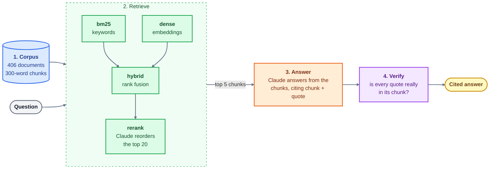

# RAG System with Evals

Ask a question about US immigration and tax rules for international students, and get a cited answer.

## Description

International students often have to piece together answers about work authorization, OPT and taxes from many government websites, and the rules change often.
This project brings official sources into one searchable collection of **406 documents** and answers questions from them.

It is a retrieval-augmented generation (RAG) system. It finds the passages that matter, then asks Claude to answer **only from those passages** and to quote the text it used. Every quote is checked against the source, so the answer can be trusted or challenged.

The project also measures the search itself. Four retrieval systems are compared on 34 questions with known answers, and every score has a confidence interval, so a difference is claimed only when the data supports it.

It was built for a course project (CSCI 498E/598E, Coding with AI Agents).

## Architecture



*The diagram is drawn by GitHub; in an editor without Mermaid support it shows as text.*

**1. Corpus** (`corpora/own/`)
- Each document is a Markdown file, with a `manifest.tsv` row that records its source and license.
- Documents are cut into 300-word chunks with a 50-word overlap, so search and citations point at small pieces of text.

**2. Retrieve** (`p2/retrievers/`)
- `bm25` is keyword search. It is fast and good at exact terms such as form numbers.
- `dense` turns text into vectors with OpenAI's `text-embedding-3-small` and finds the closest chunks. It is good at questions worded differently from the documents.
- `hybrid` combines the bm25 and dense rankings with reciprocal rank fusion.
- `rerank` takes the top 20 from hybrid and asks Claude to put them in the best order for the question.

**3. Answer** (`p2/answer.py`, `prompts/answer.txt`)
- The top 5 chunks go to Claude, with instructions to answer only from them.
- The reply has an answer and a list of claims. Each claim names the chunk it came from and quotes it.
- If the chunks do not contain the answer, the system says so instead of guessing.

**4. Verify** (`p2/verify.py`)
- Checks that every quote appears word for word in the chunk it cites.

**5. Evaluate** (`eval/own/`, `runs/own/`, `EVAL.md`), which sits outside the question-to-answer flow above
- Each question has relevance judgments: which documents really answer it.
- `p2 score` compares the systems with Recall@10, MRR@10 and nDCG@10, and adds paired 95% confidence intervals and the smallest difference the question set could detect.
- `PREREG.md` holds a claim written down before the results, and `EVAL.md` has the full write-up.

**Demo** (`demo.py`)
- A terminal program: type a question, see the answer, the evidence with verified quotes, and the chunks it used.

## Setup

**You need**
- Python 3.12 and [uv](https://docs.astral.sh/uv/)
- The [Claude Code](https://claude.com/claude-code) command line, signed in. Reranking and answering run through `claude -p` on your own plan.
- An OpenAI API key, only for `dense`, `hybrid`, `rerank` and the demo when you ask a new question. The checks and the committed runs need no key.

**Steps**

```bash
git clone https://github.com/VarshaSathiskumar/RAG-system-with-evals.git
cd RAG-system-with-evals
uv sync

# put your own OpenAI key in a file named .env (git ignores it; never commit it)
echo 'OPENAI_API_KEY=<your key>' > .env

uv run p2 check            # verify the whole project
uv run python demo.py      # ask questions in the terminal
```

**Useful commands**

| Command | What it does |
|---|---|
| `uv run python demo.py` | Ask questions in the terminal (type `:help` for commands) |
| `uv run python demo.py --system bm25` | Demo with keyword search only (no OpenAI key needed) |
| `uv run p2 run --corpus own --queries own --system hybrid` | Run one retrieval system on the 34 questions |
| `uv run p2 score` | Compute the scores and intervals and update `EVAL.md` |

Each demo question makes one or two Claude calls (two with `rerank`). Replies are cached, so asking the same question again is instant.

## Dataset

| | |
|---|---|
| Topic | US immigration, work authorization and tax rules for international (F-1) students |
| Documents | 406 |
| Size | 3.6 MB, about 552,000 words |
| License | US government work (public domain) |
| Format | One Markdown file per document, with its title on the first line |
| Questions | 34: 14 written by me, 20 drafted by Claude |
| Question types | scenario (12), direct (7), semantic (7), exact-match (5), multi-document (3) |
| Relevance judgments | 50, each made by me after reading the document |

Where the documents come from:

| Source | Documents | What it holds |
|---|---:|---|
| IRS | 198 | Tax guides and form instructions (Publication 519, Form 1040-NR, W-7, W-8BEN) |
| eCFR | 140 | Federal regulations, mostly immigration rules in 8 CFR (F-1 status, OPT, work authorization) |
| Department of Labor | 31 | Wage and hour fact sheets (internships, employment) and H-1B pages |
| USCIS | 17 | OPT and STEM OPT pages, forms and green card guidance |
| GovInfo | 12 | US Code (immigration law) |
| Other (DHS Study in the States, CBP, State Department, FinCEN, ICE) | 8 | Student status, travel, admission and reporting pages |

## Results

Scores on the 34 questions (higher is better).

| System | Recall@10 | MRR@10 | nDCG@10 |
|---|---:|---:|---:|
| bm25 | 0.833 | 0.555 | 0.599 |
| dense | 0.775 | 0.641 | 0.639 |
| hybrid | 0.858 | 0.623 | 0.660 |
| **rerank** | **0.902** | **0.763** | **0.780** |

What the numbers show:

- **Reranking is the best system.** Its gains over bm25, dense and hybrid are large enough for the data to tell apart. Over hybrid the gain in nDCG@10 is +0.120, with a 95% interval of [+0.010, +0.230].
- **The other three are too close to separate.** For nDCG@10, the gaps among bm25, dense and hybrid are too small for 34 questions to detect, so I do not rank them.
- **I wrote the claim down before the results.** "Reranking beats hybrid" came out supported, but 34 questions cannot show whether the gain reaches the 0.15 I called meaningful.
- **Fixing the reranker prompt did not help measurably.** Changing it from mine safety (the course default) to immigration moved nDCG@10 from 0.780 to 0.761, which is within noise.
- **The main weakness is truncation.** The reranker reads only the first 300 words of each document, about 22% of the text in this corpus, so it can miss the passage that answers the question.

## Future improvements

- **Rerank passages, not document openings.** Let Claude see the chunk that matches the question instead of the first 300 words.
- **Finish the relevance judgments.** Review the top results of all four systems and fix questions that are ambiguous or labeled too narrowly.
- **Use more questions.** About 39 are needed to detect a difference of 0.15, and more to show whether the reranker's gain reaches it.
- **Tune the reranker for this corpus.** Use a prompt written for it and compare other embedding models on the same runs.
- **Keep the corpus current.** Immigration rules change often, so the documents should be refreshed and re-checked for license.

---
